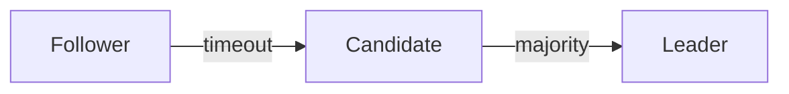

# The leader election of Raft

The paper, section 5.2, gives each server a random election timeout.

> [!hook]
> The first server to time out usually wins.

A sketch of the timer, not the code of a repository:

```c
if (now > deadline)
    become_candidate();
```



```chart
{
  "kind": "bar",
  "title": "Election time, by timeout range",
  "x": { "label": "Timeout range (ms)", "values": ["150-300", "150-151"] },
  "y": { "label": "Median election time", "unit": "ms" },
  "series": [{ "name": "5 servers", "values": [283, 1520] }]
}
```
