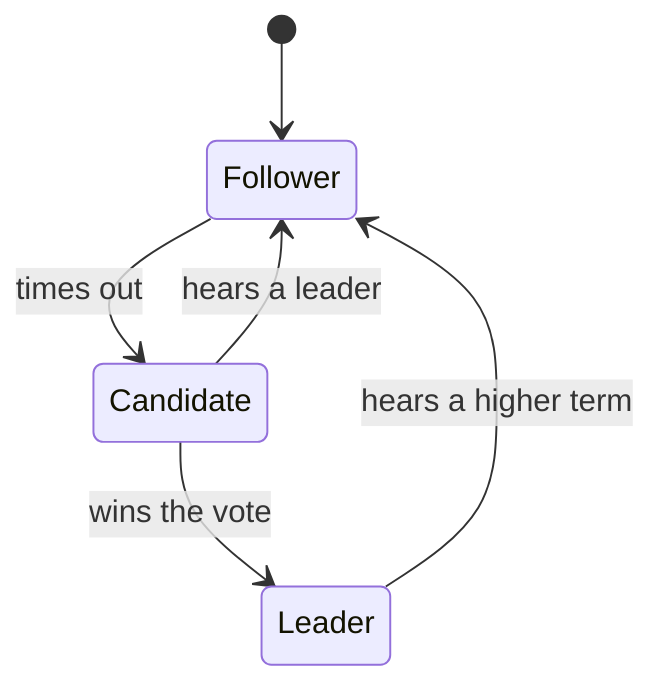
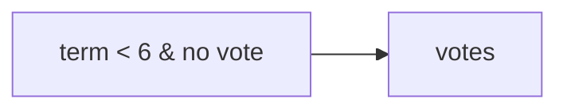

# The states of a server

A server is a follower, a candidate, or the leader.

The text after a diagram opens a new block. The source of a diagram is
kept as the agent typed it, `<` and `&` included: Mermaid escapes it.

